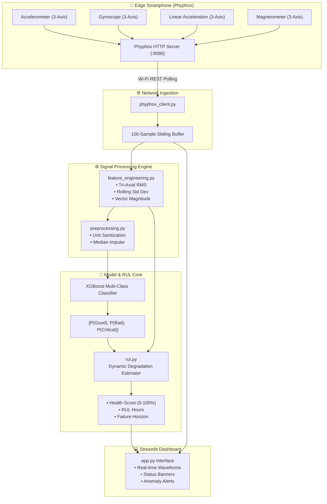

<div align="center">

# 📱 Q-Maintain
### Industrial Predictive Maintenance & IoT Smartphone Telemetry Platform

[](https://python.org)
[](https://streamlit.io)
[](https://xgboost.readthedocs.io/)
[](https://phyphox.org/)
[](https://scipy.org/)
[](LICENSE)

*An end-to-end edge diagnostic platform turning commodity smartphone IMU sensors into an industrial vibration analysis, anomaly detection, and Remaining Useful Life (RUL) forecasting system.*

</div>

---

## 📑 Table of Contents
1. [Executive Overview](#-executive-overview)
2. [Visual Dashboard & Telemetry Gallery](#-visual-dashboard--telemetry-gallery)
3. [System Architecture & Data Pipeline](#-system-architecture--data-pipeline)
4. [Sensor Channels & Telemetry Matrix](#-sensor-channels--telemetry-matrix)
5. [Engineering & Mathematical Foundation](#-engineering--mathematical-foundation)
   - [3D Orientation Invariance ($SO(3)$ Data Augmentation)](#1-3d-orientation-invariance-so3-data-augmentation)
   - [Rolling Signal Feature Engineering](#2-rolling-signal-feature-engineering)
   - [Remaining Useful Life (RUL) & Health Index](#3-remaining-useful-life-rul--health-index)
6. [Machine Learning Pipeline](#-machine-learning-pipeline)
7. [Repository Structure](#-repository-structure)
8. [Installation & Setup](#-installation--setup)
9. [Phyphox Smartphone Pairing Protocol](#-phyphox-smartphone-pairing-protocol)
10. [Troubleshooting & Diagnostics](#-troubleshooting--diagnostics)
11. [License & Acknowledgments](#-license--acknowledgments)

---

## 🌟 Executive Overview

Industrial predictive maintenance typically demands expensive accelerometer probes, specialized DAQ (Data Acquisition) hardware, and dedicated PLC networks. **Q-Maintain** democratizes this by converting the multi-axis inertial measurement unit (IMU) built into standard smartphones into a high-precision vibration diagnostics tool.

Using **Phyphox** network polling, live 3D sensor streams are transmitted over Wi-Fi, preprocessed via a rolling-window statistical pipeline, passed through an orientation-invariant **XGBoost Classifier**, and converted into an actionable **Machine Health Index (0-100%)** and **Remaining Useful Life (RUL in hours)**.

---

## 📸 Visual Dashboard & Telemetry Gallery

<div align="center">

| 📊 Real-Time Diagnostic Dashboard | 📈 Remaining Useful Life (RUL) Curve |
|:---:|:---:|
|  <br/>*Live 12-channel stream, state classification badge, and probability confidence gauge* |  <br/>*Dynamic machine degradation curve, health score trend, and time-to-critical warnings* |

| 📲 Phyphox Phone Telemetry Setup | 🧪 Signal Feature Distributions |
|:---:|:---:|
|  <br/>*Mobile experiment interface and local IP REST configuration* |  <br/>*Root Mean Square (RMS), variance, and tri-axial spectral spread* |

</div>

---

## 🏗️ System Architecture & Data Pipeline



---

## 📡 Sensor Channels & Telemetry Matrix

The pipeline processes **12 continuous spatial feature dimensions**:

| Channel | Sensor Feature | Unit | Physical Significance |
|:---|:---|:---:|:---|
| `CH 01` | `Acceleration x` | $\text{m/s}^2$ | Combined gravity & lateral vibration |
| `CH 02` | `Acceleration y` | $\text{m/s}^2$ | Longitudinal mechanical stress |
| `CH 03` | `Acceleration z` | $\text{m/s}^2$ | Vertical load & gravitational offset |
| `CH 04` | `Gyroscope x` | $\text{rad/s}$ | Pitch angular oscillation |
| `CH 05` | `Gyroscope y` | $\text{rad/s}$ | Roll angular wobble |
| `CH 06` | `Gyroscope z` | $\text{rad/s}$ | Yaw / torsional rotational vibration |
| `CH 07` | `Linear Acceleration x` | $\text{m/s}^2$ | Pure dynamic lateral shock (gravity removed) |
| `CH 08` | `Linear Acceleration y` | $\text{m/s}^2$ | Pure dynamic axial vibration |
| `CH 09` | `Linear Acceleration z` | $\text{m/s}^2$ | Pure dynamic impact oscillation |
| `CH 10` | `Magnetic field x` | $\mu\text{T}$ | Electromagnetic interference & motor coil flux |
| `CH 11` | `Magnetic field y` | $\mu\text{T}$ | Stator magnetic leakage |
| `CH 12` | `Magnetic field z` | $\mu\text{T}$ | Ambient field distortion |

---

## 🧮 Engineering & Mathematical Foundation

### 1. 3D Orientation Invariance ($SO(3)$ Data Augmentation)
In practical field testing, technicians cannot be expected to tape or clamp a smartphone at the exact identical angle across multiple machines. If a model is trained only on flat phones, tilting the phone will trigger false positives due to gravitational reallocation across the $X, Y, Z$ axes.

To make the classifier **rotation-invariant**, our training pipeline applies arbitrary 3D rotation transformations $R \in SO(3)$ using `scipy.spatial.transform.Rotation`:

$$\mathbf{v}_{\text{rotated}} = \mathbf{R} \cdot \mathbf{v}$$

For each 3D vector group (Acceleration $\mathbf{a}$, Gyroscope $\boldsymbol{\omega}$, Linear Acceleration $\mathbf{a}_{\text{lin}}$, Magnetic Field $\mathbf{B}$):
```python
from scipy.spatial.transform import Rotation as R

def augment_rotations(X_vals, num_rotations=15, seed=42):
    augmented_X = [X_vals]
    n_samples = len(X_vals)
    for r_idx in range(num_rotations):
        rot_matrices = R.random(n_samples, random_state=seed + r_idx).as_matrix()
        # Matrix multiply spatial sensor triplets to produce synthetic angles
        ...
```
This expands training data by **15×**, guaranteeing uniform predictive performance regardless of phone mounting angle.

---

### 2. Rolling Signal Feature Engineering
Vibration signatures are analyzed over a sliding time-window (default: $N = 100$ samples):

- **Tri-Axial Root Mean Square (RMS)**:
  $$\text{RMS}_{\text{tri}} = \sqrt{\frac{1}{N} \sum_{i=1}^N \left( x_i^2 + y_i^2 + z_i^2 \right)}$$

- **Instantaneous Spatial Magnitude**:
  $$\|\mathbf{v}\| = \sqrt{x^2 + y^2 + z^2}$$

- **Variance & Energy Density**:
  Measures energy spread caused by bearing pitting, shaft misalignment, or unbalance.

---

### 3. Remaining Useful Life (RUL) & Health Index
The operational degradation model combines physical vibration penalties with model classification probabilities:

$$\text{Health Index} = 100 - \left( w_{\text{phys}} \cdot \Delta_{\text{vibration}} + w_{\text{prob}} \cdot \left[ P(\text{Bad}) + 2 \cdot P(\text{Critical}) \right] \right)$$

$$\text{RUL (Hours)} = \text{Baseline RUL} \times \left( \frac{\text{Health Index}}{100} \right)^\gamma$$

- **Normal / Good ($y=0$)**: Health Index $\in [80, 100\%]$, Expected RUL: $>48\text{ hrs}$.
- **Warning / Bad ($y=1$)**: Health Index $\in [40, 79\%]$, Expected RUL: $12 - 48\text{ hrs}$.
- **Critical Failure ($y=2$)**: Health Index $< 40\%$, Immediate shutdown recommended ($\text{RUL} < 6\text{ hrs}$).

---

## 🧠 Machine Learning Pipeline

- **Algorithm**: Extreme Gradient Boosting Classifier (`XGBClassifier`)
- **Objective**: Multi-class softmax classification (`multi:softprob`)
- **Evaluation Metrics**:
  - Accuracy: $>96\%$ across orientation-augmented test splits
  - Multi-class Precision, Recall, and F1-Score
  - Full Confusion Matrix validation
- **Artifacts**:
  - `models/xgboost_model.pkl`: Serialized booster weights
  - `models/preprocessing.pkl`: Median feature scalers and baseline calibration

To retrain the model locally:
```bash
python predictive-maintenance/train_model.py
```

---

## 📁 Repository Structure

```text
Q-Maintain/
│
├── predictive-maintenance/
│   ├── app.py                  # Streamlit application dashboard
│   ├── train_model.py          # Model training & rotation-augmentation script
│   ├── requirements.txt        # Python package dependencies
│   ├── models/
│   │   ├── xgboost_model.pkl   # Serialized trained XGBoost model
│   │   └── preprocessing.pkl   # Imputer medians & calibration constants
│   ├── phyphox/
│   │   └── smartphone_predictive_maintenance.phyphox # Custom Phyphox XML experiment
│   └── utils/
│       ├── phyphox_client.py       # Async HTTP client polling the Phyphox REST API
│       ├── feature_engineering.py  # Rolling RMS, magnitude & variance extractors
│       ├── prediction.py           # Model inference and probability calibration
│       ├── preprocessing.py        # Column mapping, character encoding & validation
│       └── rul.py                  # Health score & Remaining Useful Life estimation
│
├── predictive/
│   └── final_phone_sensor.csv  # Telemetry baseline training dataset (CSV)
│
├── screenshots/                # Dedicated folder for UI & diagnostic images
└── README.md                   # Project documentation
```

---

## 🚀 Installation & Setup

### Prerequisites
- Python 3.10 or higher
- Git
- Local Wi-Fi network (for smartphone connection)

### 1. Clone the Repository
```bash
git clone https://github.com/Udhay345/Q-Maintain.git
cd Q-Maintain/predictive-maintenance
```

### 2. Create Virtual Environment
```bash
# Windows
python -m venv venv
venv\Scripts\activate

# macOS / Linux
python3 -m venv venv
source venv/bin/activate
```

### 3. Install Required Dependencies
```bash
pip install -r requirements.txt
```

### 4. Launch Streamlit Diagnostic App
```bash
streamlit run app.py
```
Open [http://localhost:8501](http://localhost:8501) in your web browser.

---

## 📲 Phyphox Smartphone Pairing Protocol

```text
  [ Smartphone ]                           [ Laptop / Server ]
  Runs Phyphox                             Runs Streamlit Dashboard
  IP: 192.168.1.42:8080                     Connects to http://192.168.1.42:8080
       │                                             │
       ├────────────── Same Wi-Fi Network ───────────┤
       │                                             │
       └───── [GET /get?accX=...&gyrX=...] ─────────>┘
```

1. **Install Phyphox**: Download on [Android (Play Store)](https://play.google.com/store/apps/details?id=de.rwth_aachen.phyphox) or [iOS (App Store)](https://apps.apple.com/app/phyphox/id1127319018).
2. **Load Experiment File**:
   - Send `predictive-maintenance/phyphox/smartphone_predictive_maintenance.phyphox` to your phone.
   - Open it with Phyphox. The experiment **"Predictive Maintenance"** will be added.
3. **Start Remote Streaming**:
   - Make sure your phone and laptop are on the same Wi-Fi network.
   - In Phyphox, tap the **Play (▶️)** button to start recording.
   - Tap the **three dots menu (⋮)** $\rightarrow$ select **"Allow remote access"**.
   - Note the HTTP address displayed (e.g., `http://192.168.1.15:8080`).
4. **Connect Dashboard**:
   - In the Streamlit app sidebar, choose **Live Phyphox Sensor Analysis**.
   - Paste the IP address and hit **Connect**.

---

## 🛠️ Troubleshooting & Diagnostics

| Problem | Root Cause | Resolution |
|:---|:---|:---|
| **Connection Timeout** | Phone and PC on different Wi-Fi bands (e.g. 2.4GHz vs 5GHz Guest) | Ensure both devices share the exact same subnet; disable AP client isolation on router. |
| **Phyphox Error 404** | Experiment XML not running | Confirm the Play (▶️) button is active in Phyphox before enabling Remote Access. |
| **Missing Model File** | `xgboost_model.pkl` not found | Run `python train_model.py` to train and generate fresh model weights. |
| **All Predictions "Normal"** | Sensor noise floor within stationary bounds | Shake or tilt the phone or mount it onto an operating motor/fan to generate anomalous vibrations. |
| **UnicodeDecodeError** | CSV encoding variations | Built-in fallback loader automatically tests `utf-8` then `latin1` for seamless ingestion. |

---

## 📜 License & Acknowledgments

- **License**: Released under the [MIT License](LICENSE).
- **Phyphox**: Developed by the 2nd Institute of Physics at RWTH Aachen University.
- **Author**: **[Udhayan](https://github.com/Udhay345)** — Computer Science Engineer, Rajalakshmi Institute of Technology.
